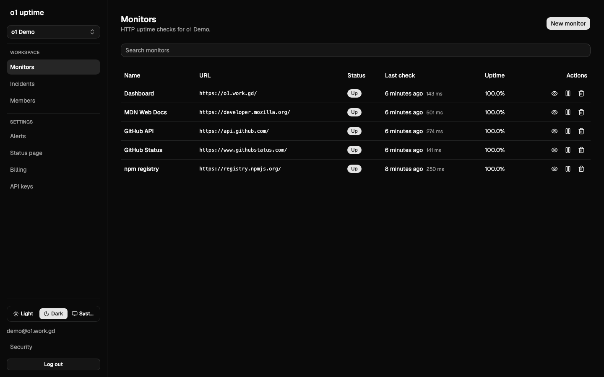
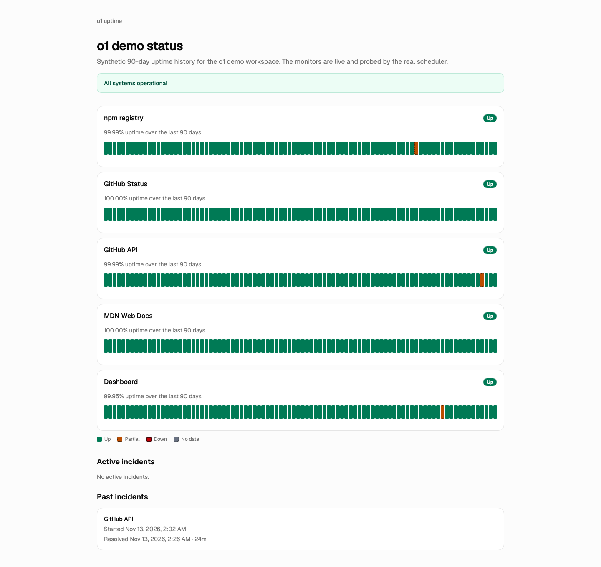
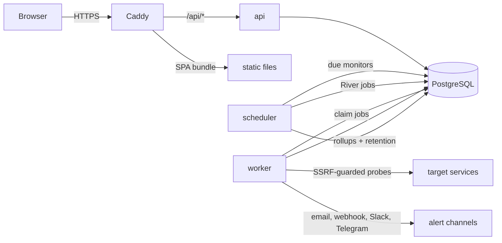
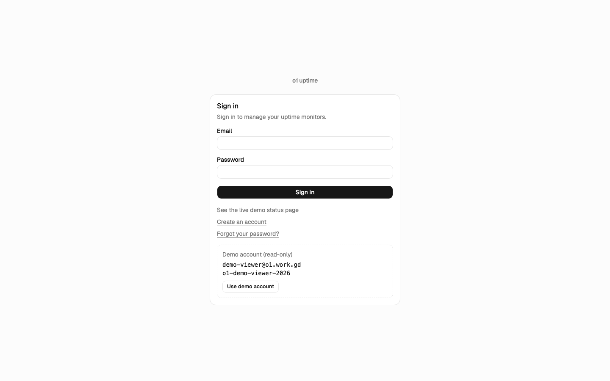
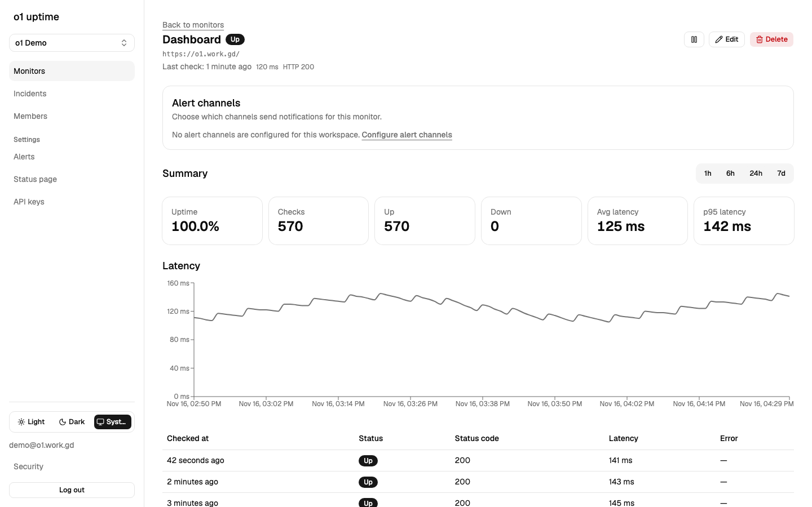
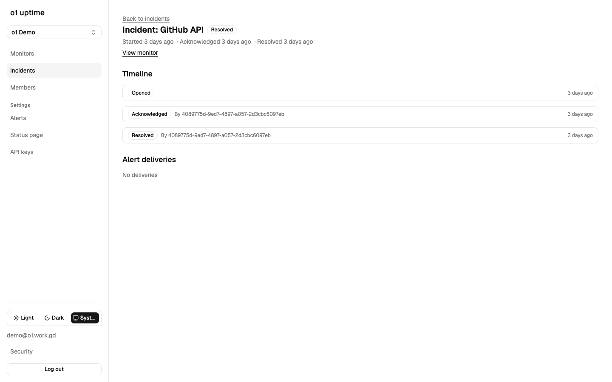
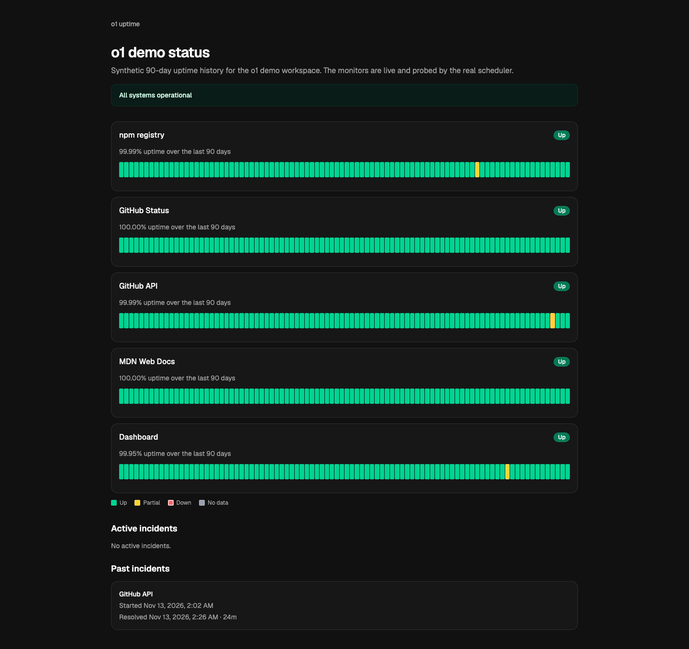
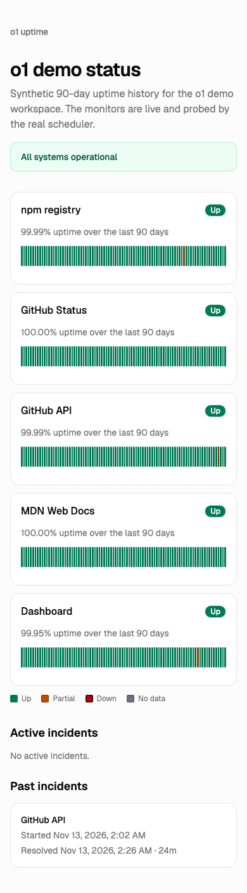

# o1 — uptime and incident monitoring

**Live:** <https://o1.work.gd> · **Public status page:** <https://o1.work.gd/status/demo> ·
**30-second tour:** [demo.mp4](docs/portfolio/demo.mp4)

**Demo viewer:** `demo-viewer@o1.work.gd` / `o1-demo-viewer-2026` — read-only,
so the dashboard can be opened without creating an account (the demo command in
the README seeds it). The status page needs no login at all.

o1 watches HTTP endpoints for small teams: it probes on a schedule, opens and
resolves incidents, notifies people, and publishes a public status page. It is
a full product, not a demo of one — authentication, workspaces and roles,
two-factor login, API keys, an audit trail, alerting over email, webhooks,
Slack and Telegram, and a production deployment pipeline.

The interesting part is not the CRUD. It is the parts that are hard to get
right: probing untrusted URLs safely, keeping 90 days of history cheap enough
to query, deleting old data without losing the summaries that depend on it, and
delivering alerts exactly once through providers that fail in different ways.

| | |
|---|---|
| **Backend** | Go 1.26, PostgreSQL 16, River job queue, goose migrations, OTLP/Sentry |
| **Frontend** | React 19, TanStack Router + Query, Tailwind 4, Radix/shadcn |
| **Ops** | Docker Compose, Caddy (TLS), GitHub Actions, GHCR, Trivy, Prometheus/Grafana/Loki |
| **Size** | ~23k lines of Go and ~24k of TypeScript, 538 Go test functions, 390 frontend tests |



## What it does

- **Monitors and probes.** HTTP checks with method, headers, body, expected
  status, interval, timeout, and confirmation/recovery thresholds. Results land
  in monthly range partitions; probes never follow redirects into private
  networks.
- **Incidents.** A monitor opens an incident after N consecutive failures and
  resolves it after N successes. Incidents can be acknowledged, stop reminders,
  and keep a timeline.
- **Alerts.** Email (Resend or authenticated SMTP), webhooks with optional
  HMAC-SHA256 signing, Slack incoming webhooks, and Telegram. Per-monitor
  switches, delivery history, retries for transient errors.
- **Public status pages.** One page per workspace at `/status/{slug}` with 90
  daily bars, uptime, and recent incidents. No monitor URLs, errors, or
  acknowledgement data ever leak to it.
- **Teams and accounts.** Owner/admin/member/viewer roles, workspace-scoped
  resources, TOTP two-factor with recovery codes, hashed API keys for scripts,
  and an admin audit trail that attributes actions to a user or an API key.



## Architecture



Three binaries share one image and one database. All three run migrations on
startup behind a PostgreSQL advisory lock. Compose runs them with Mailpit,
Caddy, and the dashboard; the production stack is a separate file with no
development defaults, only ports 80/443 exposed, and a managed PostgreSQL.

## Four decisions worth reading

### 1. Probing untrusted URLs without becoming an SSRF proxy

Users type URLs, so the server must assume every one is hostile. Validation is
not enough on its own: DNS can change between check and connect, and a redirect
can point anywhere.

The guard resolves the host, rejects loopback, private, link-local, multicast
and cloud-metadata ranges, checks the scheme, port, userinfo and fragment, and
then **dials the IP it validated** rather than the hostname — so the address
cannot change after the check. The same transport is used for redirects, which
are limited and re-validated, and probes never send credentials to a new host.
Alert destinations (webhooks, Slack) go through the same policy at save time
and again before every send.

[probe/policy.go](backend/internal/probe/policy.go) ·
[probe/probe.go](backend/internal/probe/probe.go) ·
[alerts/config.go](backend/internal/alerts/config.go)

### 2. 90 days of history that stays cheap to query and safe to delete

Raw probe rows are the biggest table by far. They are stored in UTC monthly
range partitions, so retention can drop a whole month instead of running a
huge `DELETE`. Hourly aggregates (`monitor_hourly_stats`) back the status page
and the 90-day uptime, with up/min/max/p95 latency.

Deleting raw data is the risky part: once it is gone, a rollup can no longer be
recomputed. A partition is dropped only when it is wholly past the raw cutoff
**and** either past the rollup window or fully covered by hourly rollups whose
check counts match the raw counts. The rollup watermark must be at or past the
partition end before counts are compared; a mismatch triggers one re-roll and
otherwise defers the partition to a later run. Retention is a dry run by
default, logs every candidate, and drops at most one partition per run.

[00009_rollups.sql](backend/internal/db/migrations/00009_rollups.sql) ·
[rollup/rollup.go](backend/internal/rollup/rollup.go) ·
[retention/retention.go](backend/internal/retention/retention.go) ·
[retention/prune.go](backend/internal/retention/prune.go) ·
[statuspage/service.go](backend/internal/statuspage/service.go)

### 3. Alerts that fail the way real providers fail

Email, webhooks, Slack and Telegram disagree about what a retry means. The
notifier classifies failures instead of retrying blindly: timeouts, 408, 425,
429 and 5xx are transient and retried up to five times with backoff; other 4xx
and any 3xx are permanent and recorded as failed deliveries. Email sends carry
an idempotency key, so a lost response does not duplicate a message.

Channel secrets (webhook URLs, signing secrets, bot tokens) are write-only: the
API returns a masked preview or a "configured" flag, values are encrypted at
rest with AES-GCM, and they never appear in delivery history, logs, or error
bodies.

[alerts/notifier.go](backend/internal/alerts/notifier.go) ·
[alerts/config.go](backend/internal/alerts/config.go) ·
[email/resend.go](backend/internal/email/resend.go)

### 4. Tenant isolation that is provable, and automation that is attributable

Every query is scoped by workspace, and cross-tenant access returns `404`
rather than `403`, so a caller cannot probe what exists elsewhere. Roles are
enforced at the handler boundary, and suspended workspaces keep reads while
losing mutations and probes.

API keys are shown once, stored as SHA-256 hashes with a public prefix, scoped
to one workspace, rate limited per key, and never carry global admin rights.
Every security-relevant action writes an audit event with the workspace, the
acting user, and the acting API key when one was used. Audit writes are
best-effort by design: a failed insert logs a warning and never fails the
action it was recording.

[httpx/middleware.go](backend/internal/httpx/middleware.go) ·
[workspaces](backend/internal/workspaces) ·
[apikeys/service.go](backend/internal/apikeys/service.go) ·
[audit/audit.go](backend/internal/audit/audit.go)

## Engineering practice

- **Tests are the gate.** 538 Go test functions (unit plus testcontainers
  integration against real PostgreSQL) and 390 frontend tests. Playwright
  drives the deployed stack end to end, including 2FA, recovery codes, API key
  authorization, audit attribution, and the accessibility checks.
- **CI is blocking.** Five required jobs: backend, integration, frontend, e2e,
  pipeline (actionlint, shellcheck, Compose and deploy-script suites). Trivy
  scans the filesystem and both images before any push.
- **Releases are deliberate.** Tags build `linux/amd64` images, scan them, and
  publish by digest. Deploys are dispatched by hand, run from `main` for
  production, and rollback restores the previous release bundle.
- **The system is observable.** Prometheus metrics on private listeners, OTLP
  tracing, Sentry with request data stripped, and a Grafana Alloy bundle that
  ships metrics and logs to Grafana Cloud.
- **The security work is measured, not asserted.** A blocking dependency gate,
  a written threat model, and a k6 baseline with committed results
  ([`docs/security/load-test.md`](docs/security/load-test.md)).
- **The demo data says it is demo data.** A `seed` command builds a labelled
  workspace with synthetic 90-day history and real public monitors; the status
  page description states the history is generated.

## Running it

```sh
docker compose up --build            # dashboard :5173, API :8080, Mailpit :8025
```

Production runbook: [`deploy/production/README.md`](deploy/production/README.md).
Release and deploy guide: [`deploy/CICD.md`](deploy/CICD.md).

## Security and capacity

The security pass shipped. `govulncheck` blocks on the shipping packages
(`./cmd/...`) and reports zero reachable vulnerabilities on Go 1.26.11; a
full-module advisory scan stays visible. The threat model names the trust
boundaries, the access-control matrix, and nine residual risks; the review
checklist turns it into repeatable checks. Caddy runs unprivileged with a
hashed-script CSP, and the load baseline records p95/p99, the dataset, and the
first bottleneck (the database connection pool). See
[`docs/security/`](docs/security/).

## Screenshots

| | |
|---|---|
|  |  |
|  |  |
|  | |
